<p align="center">
  
  <br>
  <a href="https://github.com/nadiwerk/trust-no-agent/actions/workflows/ci.yml"></a>
  <a href="LICENSE"></a>
</p>

Your agent says "done." But did you **verify** it — mechanically, not by
trusting the model's tone?

trust-no-agent is a **trust layer** for AI coding agents. It answers four
questions every developer has after an agent finishes:

1. **"Is it actually correct?"** — Every "done" claim must carry fresh
   verification evidence. A commit without it is **rejected mechanically** —
   not by asking the model nicely.
2. **"What do I do next?"** — Every work unit closes with a receipt that
   names the next concrete step. You are never left guessing.
3. **"Why does the same bug keep coming back?"** — A fix without a lesson is
   a repeat in waiting. Every repair feeds a corrective tier, and recurring
   failures become permanent rules — the fix outlives the session.
4. **"Can I trust the agent with destructive actions?"** — Commit, push,
   publish, and delete are **vetoed** without your explicit sign-off, and an
   irreversible action without fresh test evidence is blocked before it runs.

## Install

**Claude Code**

```bash
claude plugin marketplace add nadiwerk/trust-no-agent
claude plugin install trust-no-agent@trust-no-agent
```

**Codex**

```bash
codex plugin marketplace add nadiwerk/trust-no-agent
codex plugin add trust-no-agent@trust-no-agent
```

**Any other harness**

```bash
npx skills add nadiwerk/trust-no-agent
```

That single line delivers all 12 skills **including the onboarder itself** —
the setup-tna skill carries byte-identical copies of the router and the core
rules in its payload. Project already has its own router, or your harness has
no skill system? The merge path, the manual copy fallback, and per-harness
overrides: [docs/installation.md](docs/installation.md) — and what each
harness guarantees (veto vs audit-only):
[docs/compatibility.md](docs/compatibility.md).

Then type **`/setup-tna`** in your chat session — the agent asks for your
consent, copies the router into the project root, asks which workflow you
use (the built-in chain, your own, or both), runs the consent + skill
mapping flow, and closes with a doctor-lite proof.

The skills alone are inert — fresh agents self-triggered them **0 out of 3
times** in evals. The router forces the discipline to load; the plugin wires
the enforcement. ([docs/design.md](docs/design.md))

## Bring your own workflow

The trust layer works with **any** workflow — the built-in chain is one
option, not a requirement. Already using skills from another repo
([mattpocock/skills](https://github.com/mattpocock/skills),
[obra/superpowers](https://github.com/obra/superpowers),
[addyosmani/agent-skills](https://github.com/addyosmani/agent-skills),
[pstack](https://github.com/cursor/plugins/tree/main/pstack)) — and yours?
Any skill you already have installs alongside TNA: the onboarding detects
and maps them as overlays, and the receipts, the veto, and the consent gate
apply to every action regardless of which workflow produced the code.

## The core

Most agent workflows stop at output. This one stops at a **proof boundary**:
the router makes the next action explicit, asks for decisions when the request
is underspecified, and rejects a completion claim that has no fresh evidence
behind it. Every unit of work travels the same loop —
**claim → evidence → receipt → guardrail**:

| Stage | What happens |
|---|---|
| **claim** | The agent says what changed — specific, named files and commands, never a vibe of progress. |
| **evidence** | A test, command, or rendered result checks the claim — run fresh in this session, never quoted from an earlier run. |
| **receipt** | The outcome is recorded: what passed, what failed, what stays open — visible in chat, appended to the ledger. |
| **guardrail** | Accepted findings become router rules for the next session — the same failure cannot silently recur. |

The point is not ceremony. It is to make the expensive failure visible while
it is still cheap to change ([docs/design.md](docs/design.md)).

## The verification gates

Four repo commands are the minimum boundary a change must cross before it
may be called done. Each proves a different property:

```bash
node scripts/validate.mjs        # structure: frontmatter, cross-refs, ownership
node scripts/eval.mjs            # discipline: router rules pinned by checks that can fail
node scripts/tickets.test.mjs    # tickets: the ticket-graph validator behaves as specified
node scripts/doctor.test.mjs     # doctor: the install self-check behaves as specified
```

CI runs the full gate suite on every push — dozens of expectations across
these and the remaining suites (changelog-guard, plugin-mirror, ledger-audit,
onboarding, receipt-enforcement, and more) — and the pre-commit hook rejects
a commit that skips them. Exit zero is the minimum boundary, not a promise
that intent was correct: the gates check the framework's structure and
behavior; they do not pretend to prove your product intent. That distinction
is part of the contract.

## The four Iron Laws

```
NO ACTING until the user confirms shared understanding.        (breakpoint)
NO PRODUCTION CODE WITHOUT A FAILING TEST FIRST.              (expect-fail)
NO "DONE" CLAIM WITHOUT FRESH VERIFICATION EVIDENCE.        (receipts)
NO EXPENSIVE, IRREVERSIBLE, OR SHARED-SYSTEM ACTION WITHOUT EXPLICIT HUMAN SIGN-OFF.
```

Three of the four are enforced by **mandatory skills** the router loads before
the relevant work starts — self-trigger was measured unreliable, so forcing is
the design.

## The chain (one workflow option)

```
breakpoint → save-as → fork-it → make-it-so → roast-my-code → ship-log
```

This is the built-in workflow — use it if you don't have one, or skip it and
bring your own. Bugs take their own path: `root-cause` → `expect-fail` →
fix → `receipts`. Small work skips the chain but never the gates.

## The enforcement layer

The parts that never depend on the model choosing to comply:

- **Receipt enforcement** — a "done" claim without a valid receipt is rejected
  at commit time; the receipt shape is validated (each verification claim
  carries its own evidence), cited commands must be repo gates, and claims
  older than 14 days are stale by computation and re-verified before they gate.
- **Hooks** — the discipline floor re-injects after compaction; a prompt
  classifier routes test/bug/done work to its mandatory skill; destructive
  actions wait for sign-off.
- **Veto** — irreversible actions are denied, not discouraged: `git commit`,
  `git push`, `npm publish`, `rm -rf` are blocked until fresh test evidence
  exists (see the TNA gates below). The veto layer reaches five harnesses
  (OpenCode, Claude Code, Codex, OMP, Pi), each with a real deny contract.
- **TNA gates** — the named enforcement core behind the veto: `tna-gate`
  records session evidence (which test commands ran and whether they exited
  clean) in `.trust/tna-gate-state.json`, and `action-gate` classifies
  irreversible commands against that record. The same core runs on all five
  harnesses, so the veto follows you across tools.
- **Engagement criteria** — the chain engages by counting (more than one file,
  a design choice, an unknown-cause bug), never by mood.
- **Workflow choice** — the onboarding asks which workflow you use (built-in
  chain, your own, or both) and records it in the stamp; the gates apply
  regardless.
- **Review integrity** — review subagents never see the orchestrator's verdict;
  delegated reports without the verified SHA and method are dropped.
- **Labeled claims** — every prose claim is measured, inferred, or a guess, in
  the same sentence.
- **Doctor** — one command verifies the install is actually wired, not just
  recited.
- **CI** — thirty gates run on every push; every rule in the router is pinned
  by a check that was proven able to fail (encode-twice).

## The 12 skills

### Engineering

| Skill | Invoked by | What it does | Use cases |
|---|---|---|---|
| `breakpoint` | model | Execution pauses — the agent interviews the user | [docs/skills/breakpoint.md](docs/skills/breakpoint.md) |
| `scribe` | user | Interview + writes glossary/ADRs as you go | [docs/skills/scribe.md](docs/skills/scribe.md) |
| `save-as` | user | Conversation → spec (PRD), synthesis only | [docs/skills/save-as.md](docs/skills/save-as.md) |
| `fork-it` | user | Plan → tracer-bullet tickets with blocking edges | [docs/skills/fork-it.md](docs/skills/fork-it.md) |
| `make-it-so` | user | Build from spec/tickets, test-first | [docs/skills/make-it-so.md](docs/skills/make-it-so.md) |
| `expect-fail` | model | Fail-first reference — good tests, seams, anti-patterns | [docs/skills/expect-fail.md](docs/skills/expect-fail.md) |
| `root-cause` | model | Root-cause-first debugging — no fixes before investigation | [docs/skills/root-cause.md](docs/skills/root-cause.md) |
| `roast-my-code` | model | Three-axis review, parallel subagents, severity labels | [docs/skills/roast-my-code.md](docs/skills/roast-my-code.md) |

### Discipline

| Skill | Invoked by | What it does | Use cases |
|---|---|---|---|
| `receipts` | model | No "done" claim without fresh verification evidence | [docs/skills/receipts.md](docs/skills/receipts.md) |
| `no-thanks` | model | Receive review feedback with rigor — verify before implementing | [docs/skills/no-thanks.md](docs/skills/no-thanks.md) |

### Meta

| Skill | Invoked by | What it does | Use cases |
|---|---|---|---|
| `ship-log` | model | Append-only private ledger + self-review + rulings | [docs/skills/ship-log.md](docs/skills/ship-log.md) |
| `setup-tna` | user | Chat-guided onboarding — router copy, consent, workflow choice, skill mapping, doctor-lite proof | [docs/skills/setup-tna.md](docs/skills/setup-tna.md) |

## The ledger

Every completed unit is appended to a private, gitignored ledger
(`.trust/progress.txt`) — append-only, one dated entry per unit: the verdict,
the evidence, the ruling behind any decision made, and the next step. It is
the memory that survives compaction and fresh sessions: when work resumes,
the next step is read from the ledger, never guessed from partial memory.
Recovered findings become router rules (gated, scoped, reversible:
[docs/rule-inheritance.md](docs/rule-inheritance.md)).

## Portability

The core ships as markdown: no MCP servers, no background tasks, nothing to
run beyond the verification commands. It works on any harness that reads
`AGENTS.md`; verified matrix across ten harnesses with evidence levels:
[docs/compatibility.md](docs/compatibility.md).

## Honest limits

- **It verifies testability, not intent.** The upstream gate forces specs to be
  *testable*, not *true* — wrong intent stays possible, only cheap to catch.
- **It does not make a weak model strong.** It catches silent failures and
  forbids dishonest claims; output quality still comes from the model.
- **It does not enforce itself.** Skills are text; what never depends on the
  model is the mechanical layer above — hooks, CI, and the doctor.

## Contributing

Work only counts when it exits zero — contributions included. Full guide:
[CONTRIBUTING.md](CONTRIBUTING.md).

```bash
git config core.hooksPath scripts/hooks   # once — the same gate then runs on every commit
```

Before pushing, the core four gates must exit 0 — `node scripts/validate.mjs
&& node scripts/eval.mjs && node scripts/tickets.test.mjs &&
node scripts/doctor.test.mjs`; CI runs the full thirty. Conventional Commits;
`CHANGELOG.md` updated for user-visible changes; security issues via the
private path in [SECURITY.md](SECURITY.md).

## License

MIT — built for our own daily work, released for everyone who runs coding
agents.
